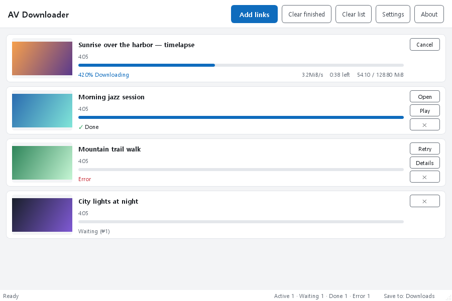
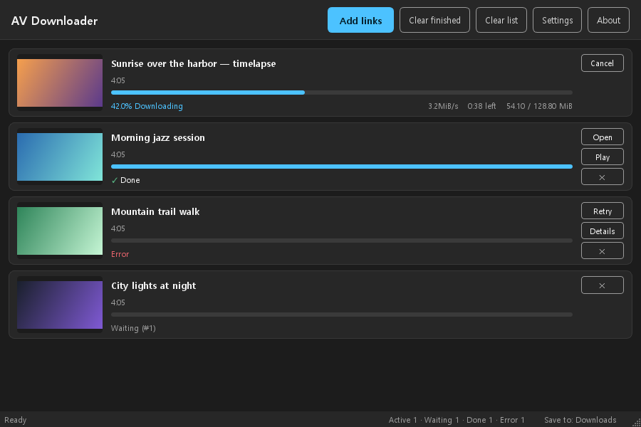
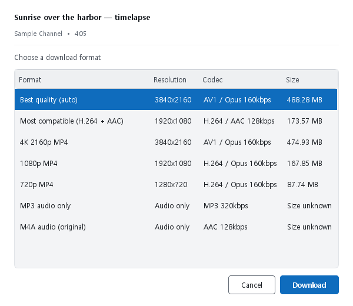
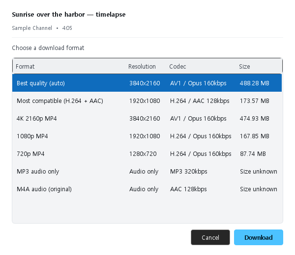

<p align="center">
  <strong>Language:</strong>
  <a href="README.md">English</a> |
  <a href="README.ko.md">한국어</a> |
  <a href="README.zh-CN.md">简体中文</a> |
  <a href="README.ja.md">日本語</a> |
  <a href="README.es.md">Español</a> |
  <a href="README.ru.md">Русский</a>
</p>

この文書は英語版を AI で翻訳したものです。内容が異なる場合は英語版に従ってください。

# AVD

<p align="center">
  <a href="https://github.com/metapbl/AVD/releases"></a>
  <a href="LICENSE"></a>
  <a href="#必要環境"></a>
  <a href="#必要環境"></a>
</p>

yt-dlp ベースの Python 製動画・音声ダウンローダー — YouTube をはじめ 1000 以上のサイトに対応します。

## 主な機能

AV Downloader は [yt-dlp](https://github.com/yt-dlp/yt-dlp) をウィンドウで操作できるデスクトップアプリ（PySide6）です。コマンドラインなしでダウンロードできます。

- 動画・音声（MP3/M4A）のダウンロードと、メタデータ・サムネイルのファイルへの埋め込み
- 画質選択ウィンドウ：最高画質、最高互換（H.264 + AAC）、解像度ごと、MP3 または M4A。前回の選択を覚えます
- 複数の同時ダウンロードとキュー、進行状況・速度・残り時間のリアルタイム表示
- プレイリスト：必要な項目だけを選択（最大 500 件）
- 同梱の `gaindb` パッケージによる MP3 音量の正規化（ロスレス ReplayGain）
- ログイン Cookie（Firefox または cookies.txt）で、年齢制限のある動画など自分のアカウントで視聴できる動画をダウンロード
- クリップボード、Ctrl+V、ドラッグ＆ドロップ、複数行の一括貼り付けからリンクを追加
- ダーク・ライトテーマ、6 言語（English、한국어、简体中文、日本語、Español、Русский）
- yt-dlp を自動で最新に保ち、同じ名前のファイルを上書きしません

## スクリーンショット

<table>
  <tr><th>ライト</th><th>ダーク</th></tr>
  <tr>
    <td></td>
    <td></td>
  </tr>
  <tr>
    <td></td>
    <td></td>
  </tr>
</table>

`tools/make_screenshots.py` がサンプルデータで描いた画面です。画面は英語で表示されています。

## 必要環境

- **Windows 11**（リリース版は Windows x64）。**macOS** はソースから実行すれば動作します。Linux はサポートしていません：ダウンロードフォルダーを開く機能が動作しません。
- PATH 上の **ffmpeg / ffprobe** — 結合、MP3/M4A 変換、タグの埋め込みに使います。Windows：`winget install Gyan.FFmpeg` または [Gyan のビルド](https://www.gyan.dev/ffmpeg/builds/)。
- PATH 上の **Node.js** — 通常は任意ですが YouTube には必要です。YouTube が yt-dlp に JavaScript チャレンジを解かせるためです（[yt-dlp EJS](https://github.com/yt-dlp/yt-dlp/wiki/EJS)）。Deno や Bun でも動作します。Windows：`winget install OpenJS.NodeJS`。
- **Python 3.12 以降** — ソースから実行する場合のみ。

## インストール

### リリース版（Windows x64）

1. [Releases](https://github.com/metapbl/AVD/releases) から `AVD-v{バージョン}-win64.zip` をダウンロードし、任意の場所に展開します。`AVD` フォルダーができます。
2. ffmpeg と Node.js をインストールします（[必要環境](#必要環境)を参照）。リリース版には含まれていません。
3. `AVD\AVD.exe` を実行します。Python は不要です。

設定は `AVD.exe` の隣の `config.json` に保存されるので、フォルダーごと移動すると設定も一緒に移ります。

### ソースから

```bash
git clone https://github.com/metapbl/AVD.git
cd AVD
python -m venv venv
venv\Scripts\python -m pip install -r requirements.txt
```

仮想環境を作成し、アプリに必要なパッケージをその中にインストールします。macOS では `venv\Scripts\python` の代わりに `venv/bin/python` を使います。`requirements.txt` は意図的に古い yt-dlp を固定しており、アプリが最初の起動時に更新します。

## クイックスタート

```bash
venv\Scripts\python main.py
```

**AV Downloader** とバージョンがタイトルのウィンドウがシステムの言語で開き、空のリストにリンク追加の案内が表示されます。動画のリンクをコピーしてウィンドウで **Ctrl+V** を押し、画質を選んで **ダウンロード** を押します。ファイルは `Downloads` フォルダーに保存され、完了後は **開く** で確認できます。

## 使い方

- **リンクの追加** — **リンクを追加** ボタン、Ctrl+V、またはウィンドウへのドラッグ。リンクごとに画質選択ウィンドウが順に開き、プレイリストのリンクでは選択用の一覧が開きます。
- **画質** — *最高画質（自動選択）* は yt-dlp が選びます。*最高互換* はほぼどこでも再生できる H.264 + AAC の MP4 を選びます。MP3 と M4A は音声のみを保存します。
- **設定** — 保存先フォルダー、同時ダウンロード数（1〜3 推奨）、ログイン Cookie、MP3 音量の正規化、yt-dlp の自動更新確認、言語、テーマ。**保存** を押すと再起動なしで反映されます。
- **ファイル** — 同じ名前のファイルは上書きせず、新しいファイルを `Title (1).mp4` のように保存します。ダウンロード中は保存先に `.avd_*` 作業フォルダーが現れ、項目が終わると消えます。強制終了で残った作業フォルダーは、1 日後のアプリ起動時に削除されます。

## ログイン Cookie

年齢制限のある動画など、ログインが必要な動画は自分のアカウントの Cookie でダウンロードできます。**設定 > ログイン Cookie** でオンにします。既定ではオフです。

- **Firefox から読み取る** — Firefox でサイト（YouTube など）にログインしておき、これを選びます。最も簡単な方法です。
- **cookies.txt ファイル** — Chrome や Edge など他のブラウザーでは、Cookie をファイルに書き出して指定します。Windows の Chrome と Edge は Cookie を自分専用に暗号化するため、直接は読み取れません。

cookies.txt の作り方（Chrome、Edge）：

1. Chrome ウェブストアから **Get cookies.txt LOCALLY** 拡張機能をインストールします（yt-dlp のドキュメントが推奨しているもの）。似た名前の拡張機能の中には Cookie を外部に送信した例があるので、名前を正確に確認してください。
2. **シークレット（InPrivate）ウィンドウ**を開いてサイトにログインします。通常ウィンドウの Cookie はすぐにサイトに置き換えられ、書き出したファイルが使えなくなります。
3. そのウィンドウで拡張機能をクリックしてサイトの Cookie を **Export** し、シークレットウィンドウを閉じます。
4. AVD の **cookies.txt ファイル** の横の **参照** でそのファイルを指定します。

知っておくこと：

- cookies.txt にはログイン情報が含まれています。他人に渡さず、使い終わったら削除してください。
- AVD は Cookie をコピー・保存せず、cookies.txt を変更しません。設定には選んだ方式とファイルのパスだけが残ります。
- ログインしたアカウントで短時間に大量にダウンロードすると、サイトがそのアカウントを制限することがあります。
- DRM で保護されたコンテンツは、Cookie があってもダウンロードしません（[配布方針](#配布方針)）。

## プロジェクトの状況

- **Windows 11** で、ソースからの実行とリリース版の両方で開発・テストしています。変更のたびに自動テスト（pytest）を実行します。
- **macOS** でのソース実行はサポートしていますが、実際の Mac ではまだ確認していません。macOS のアプリバンドルはありません。
- 韓国語の画面が原文です。英語は AI 翻訳を開発者が確認したもので、简体中文・日本語・Español・Русский は AI 翻訳です。修正を歓迎します（下記参照）。
- 開発者 1 人が AI アシスタントと共に開発しています。リリースごとに機能が変わることがあります。[CHANGELOG.md](CHANGELOG.md) を参照してください。

## ヘルプと貢献

- **質問とバグ** — [issue](https://github.com/metapbl/AVD/issues) を作成してください。ダウンロードエラーの場合は、失敗した項目の **詳細** に表示されるテキストを添えてください。
- **プルリクエスト** — 翻訳の修正と小さなバグ修正を歓迎します。大きな変更は、まず issue を作成して方針を相談してください。
- **プルリクエストを送る前に** テストとリンターを実行してください：

  ```bash
  venv\Scripts\python -m pip install -r requirements-dev.txt
  venv\Scripts\python -m pytest
  venv\Scripts\ruff check .
  ```

  開発ツールをインストールし、全テストを実行し、コードスタイルを確認します。3 つのコマンドがすべてエラーなく終わる必要があります。
- **翻訳** は `i18n/avd_{言語}.ts` にあり、Qt Linguist（`venv\Scripts\pyside6-linguist`）で編集できます。編集後に `venv\Scripts\python tools/update_translations.py` を実行して `.qm` ファイルを作り直し、両方をコミットしてください。
- プロジェクトのルールと設計の記録は [AGENTS.md](AGENTS.md) と [docs/](docs/) にあります（韓国語）。

## セキュリティ

脆弱性は GitHub で非公開で報告してください：リポジトリの **Security** タブ → **Report a vulnerability**。公開の issue には投稿しないでください。

## 配布方針

**無料配布。** 作者は AVD を GitHub でオープンソースとして無料で配布しており、販売や有料版の提供はしません。これは作者の配布方法を説明するだけで、下記のライセンスに制限を加えるものではありません。

**DRM 回避の禁止。** DRM（技術的保護手段）の回避や、有料・制限付きコンテンツへの無断アクセスを助ける機能は追加せず、機能要望もこの方針で判断します。[ログイン Cookie](#ログイン-cookie) は自分のアカウントですでに視聴できるコンテンツのためのもので、無断アクセスにはあたりません。DRM で保護されたコンテンツは引き続きダウンロードしません。

## 免責事項

このツールは個人的な学習とバックアップのために使ってください。各サイトの利用規約と著作権法を守るのは利用者の責任であり、法律で認められる範囲でのみ、自己責任で使用してください。

このソフトウェアは、商品性や特定目的への適合性の黙示的な保証を含め、**一切の保証なく**「現状のまま」提供されます（MIT と LGPL-2.1 の両方の無保証条項）。

## クレジット

- [yt-dlp](https://github.com/yt-dlp/yt-dlp) — ダウンロードエンジン
- [PySide6](https://doc.qt.io/qtforpython-6/)（Qt for Python）— GUI
- [requests](https://requests.readthedocs.io/) — サムネイルと更新確認
- [psutil](https://pypi.org/project/psutil/) — キャンセル時の ffmpeg/Node 子プロセスの停止
- [numpy](https://numpy.org/) と [SciPy](https://scipy.org/) — `gaindb` の音量分析
- [GainDB](https://github.com/metapbl/GainDB) — mp3gain から派生した MP3 音量の正規化

## ライセンス

AVD はフォルダーごとにライセンスが異なります。

- **AVD 本体** — `MIT`。全文は [LICENSE](LICENSE)、著作権とサードパーティの表示は [NOTICE](NOTICE) を参照してください。
- **同梱の `gaindb/` パッケージ** — `LGPL-2.1-or-later`。mp3gain（LGPL-2.1-or-later）から改変したコードを含むため、同じ条件で配布します。[gaindb/LICENSE](gaindb/LICENSE)、[gaindb/NOTICE](gaindb/NOTICE)、[gaindb/THIRD_PARTY_LICENSES](gaindb/THIRD_PARTY_LICENSES) を参照してください。上流：<https://github.com/metapbl/GainDB>（同梱バージョン 1.2.0）。

AVD は `gaindb.api` の公開関数だけを呼び出すため、LGPL-2.1 §5 の「ライブラリを使用する著作物」にあたり、MIT ライセンスは影響を受けません — PySide6（LGPLv3）を動的リンクで使うのと同じです。PySide6 と Qt のソースの入手先は [THIRD_PARTY_LICENSES](THIRD_PARTY_LICENSES) の PySide6 の節にあります。LGPL を守るため、リリース版の `gaindb/` は自分の修正版に置き換えられる通常の `.py` ファイルのままにし、各 GitHub リリースにはそのタグのソースアーカイブを添付しています。
