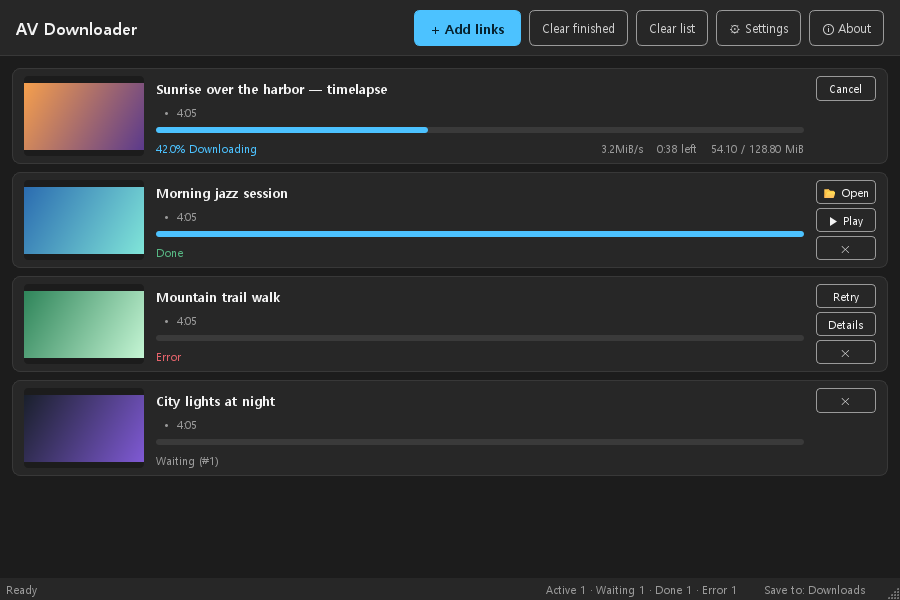
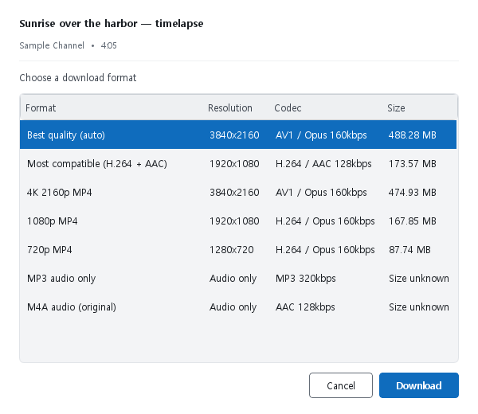
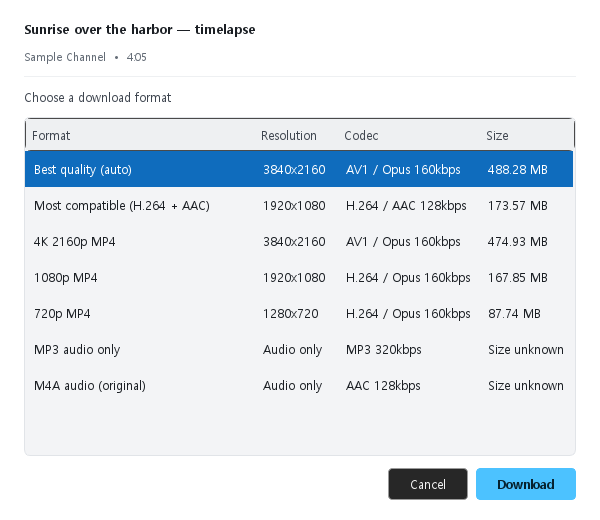

<p align="center">
  <strong>Language:</strong>
  <a href="README.md">English</a> |
  <a href="README.ko.md">한국어</a> |
  <a href="README.zh-CN.md">简体中文</a> |
  <a href="README.ja.md">日本語</a> |
  <a href="README.es.md">Español</a> |
  <a href="README.ru.md">Русский</a>
</p>

# AVD

<p align="center">
  <a href="https://github.com/metapbl/AVD/releases"></a>
  <a href="LICENSE"></a>
  <a href="#requirements"></a>
  <a href="#requirements"></a>
</p>

A Python-based video & audio downloader powered by yt-dlp — supports YouTube and 1000+ other sites.

## Features

AV Downloader is a desktop app (PySide6) that puts [yt-dlp](https://github.com/yt-dlp/yt-dlp) behind a window, so you can download without the command line.

- Video and audio (MP3/M4A) downloads with metadata and the thumbnail embedded in the file
- A quality dialog: best quality, most compatible (H.264 + AAC), each resolution, MP3 or M4A; it remembers your last choice
- Several downloads at once with a queue, live progress, speed and time left
- Playlists: pick the items you want (up to 500)
- MP3 volume normalization (lossless ReplayGain) with the bundled `gaindb` package
- Login cookies (Firefox or cookies.txt) for videos your own account can watch, such as age-restricted ones
- Links from the clipboard, Ctrl+V, drag and drop, or several lines at once
- Dark and light themes; six languages (English, 한국어, 简体中文, 日本語, Español, Русский)
- Keeps yt-dlp up to date by itself, and never overwrites a file with the same name

## Screenshots

<table>
  <tr><th>Light</th><th>Dark</th></tr>
  <tr>
    <td></td>
    <td></td>
  </tr>
  <tr>
    <td></td>
    <td></td>
  </tr>
</table>

Rendered from sample data by `tools/make_screenshots.py`; the screens show the English interface.

## Requirements

- **Windows 11** (the release build is Windows x64). **macOS** works when run from source. Linux is not supported: opening the download folder does not work there.
- **ffmpeg / ffprobe** on your PATH — for merging, MP3/M4A conversion and embedding tags. Windows: `winget install Gyan.FFmpeg` or the [builds by Gyan](https://www.gyan.dev/ffmpeg/builds/).
- **Node.js** on your PATH — optional in general but needed for YouTube, which makes yt-dlp solve a JavaScript challenge ([yt-dlp EJS](https://github.com/yt-dlp/yt-dlp/wiki/EJS)). Deno or Bun also work. Windows: `winget install OpenJS.NodeJS`.
- **Python 3.12 or later** — only when running from source.

## Install

### Release build (Windows x64)

1. Download `AVD-v{version}-win64.zip` from [Releases](https://github.com/metapbl/AVD/releases) and unzip it anywhere. You get an `AVD` folder.
2. Install ffmpeg and Node.js (see [Requirements](#requirements)). They are not included.
3. Run `AVD\AVD.exe`. Python is not needed.

Settings are kept in `config.json` next to `AVD.exe`, so moving the folder moves your settings too.

### From source

```bash
git clone https://github.com/metapbl/AVD.git
cd AVD
python -m venv venv
venv\Scripts\python -m pip install -r requirements.txt
```

This creates a virtual environment and installs the app's packages into it. On macOS use `venv/bin/python` instead of `venv\Scripts\python`. `requirements.txt` pins an older yt-dlp on purpose; the app updates it the first time it starts.

## Quick start

```bash
venv\Scripts\python main.py
```

A window titled **AV Downloader** and its version opens, in your system language, with an empty list and a hint for adding links. Copy a video link, press **Ctrl+V** in the window, choose a quality and press **Download**. The file goes to your `Downloads` folder; **📂 Open** shows it when it is done.

## Usage

- **Add links** — the **+ Add links** button, Ctrl+V, or drag links onto the window. Each link opens the quality dialog in turn; a playlist link opens a list to pick from.
- **Quality** — *Best quality (auto)* lets yt-dlp choose; *Most compatible* picks H.264 + AAC MP4 that plays almost anywhere; MP3 and M4A save audio only.
- **Settings (⚙)** — save folder, number of simultaneous downloads (1–3 recommended), login cookies, MP3 volume normalization, automatic yt-dlp update check, language and theme. Changes apply when you press **Save**, without a restart.
- **Files** — a file with the same name is never overwritten; the new one is saved as `Title (1).mp4`. While downloading, a `.avd_*` work folder appears in the save folder and disappears when the item finishes. Work folders left behind by a crash are removed a day later, when the app starts.

## Login cookies

Videos that need a signed-in account, such as age-restricted ones, can be downloaded with your own account's cookies. Turn it on in **⚙ Settings > Login cookies**; it is off by default.

- **Read from Firefox** — sign in to the site (YouTube or others) in Firefox and choose this. This is the simplest way.
- **cookies.txt file** — for Chrome, Edge and other browsers, export the cookies to a file and choose it. On Windows, Chrome and Edge encrypt cookies for their own use, so they cannot be read directly.

Making cookies.txt (Chrome, Edge):

1. Install the **Get cookies.txt LOCALLY** extension from the Chrome Web Store (the one the yt-dlp documentation recommends). Some extensions with similar names have sent cookies elsewhere, so check the name exactly.
2. Open a **private (Incognito/InPrivate) window** and sign in to the site. Cookies from a normal window are soon replaced by the site, which makes the exported file useless.
3. In that window, click the extension and **Export** the cookies for the site, then close the private window.
4. In AVD, choose the file with **Browse** next to **cookies.txt file**.

Good to know:

- cookies.txt contains your sign-in. Do not share it, and delete it when you are done.
- AVD does not copy or store cookies and never changes your cookies.txt. Only the chosen method and the file path are saved in the settings.
- Downloading a lot in a short time with a signed-in account can get that account limited by the site.
- DRM-protected content is not downloaded, even with cookies ([Distribution policy](#distribution-policy)).

## Project status

- Developed and tested on **Windows 11**, both from source and as the release build. Every change runs an automated test suite (pytest).
- **macOS** from source is supported but has not yet been checked on a real Mac. There is no macOS app bundle.
- The Korean interface is the original. English is an AI translation reviewed by the developer; 简体中文, 日本語, Español and Русский are AI translations. Corrections are welcome (see below).
- One developer, working with AI assistants. Features still change between releases; see [CHANGELOG.md](CHANGELOG.md).

## Help and contributing

- **Questions and bugs** — open an [issue](https://github.com/metapbl/AVD/issues). For a download error, include the text from **Details** on the failed item.
- **Pull requests** — translation corrections and small bug fixes are welcome. For larger changes, open an issue first so we can agree on the approach.
- **Before sending a pull request**, run the tests and the linter:

  ```bash
  venv\Scripts\python -m pip install -r requirements-dev.txt
  venv\Scripts\python -m pytest
  venv\Scripts\ruff check .
  ```

  This installs the development tools, runs the full test suite and checks the code style; all three should finish without errors.
- **Translations** live in `i18n/avd_{language}.ts` and can be edited with Qt Linguist (`venv\Scripts\pyside6-linguist`). After editing, run `venv\Scripts\python tools/update_translations.py` to rebuild the `.qm` files, and commit both.
- Project rules and design notes are in [AGENTS.md](AGENTS.md) and [docs/](docs/) (in Korean).

## Security

Please report vulnerabilities privately through GitHub: the repository's **Security** tab → **Report a vulnerability**. Do not open a public issue for them.

## Distribution policy

**Free distribution.** The author distributes AVD for free as open source on GitHub and does not sell it or offer paid editions. This only describes how the author distributes it and adds no restriction to the licenses below.

**No DRM circumvention.** Features that help bypass DRM (technical protection measures) or access paid or restricted content without permission will not be added, and feature requests are judged by this policy. [Login cookies](#login-cookies) are for content your own account can already watch; that is not unauthorized access, and DRM-protected content is still not downloaded.

## Disclaimer

Use this tool for personal study and backup. Following each site's terms of use and copyright law is your responsibility; use it only within what the law allows, at your own risk.

This software is provided "as is", **without any warranty**, including the implied warranties of merchantability or fitness for a particular purpose (the no-warranty clauses of both MIT and LGPL-2.1).

## Credits

- [yt-dlp](https://github.com/yt-dlp/yt-dlp) — the download engine
- [PySide6](https://doc.qt.io/qtforpython-6/) (Qt for Python) — the GUI
- [requests](https://requests.readthedocs.io/) — thumbnails and update checks
- [psutil](https://pypi.org/project/psutil/) — stopping ffmpeg/Node child processes on cancel
- [numpy](https://numpy.org/) and [SciPy](https://scipy.org/) — volume analysis in `gaindb`
- [GainDB](https://github.com/metapbl/GainDB) — MP3 volume normalization, derived from mp3gain

## License

AVD uses a license per folder.

- **AVD itself** — `MIT`. See [LICENSE](LICENSE) for the text and [NOTICE](NOTICE) for copyright and third-party notices.
- **The bundled `gaindb/` package** — `LGPL-2.1-or-later`. It contains code adapted from mp3gain (LGPL-2.1-or-later), so it is distributed under the same terms. See [gaindb/LICENSE](gaindb/LICENSE), [gaindb/NOTICE](gaindb/NOTICE) and [gaindb/THIRD_PARTY_LICENSES](gaindb/THIRD_PARTY_LICENSES). Upstream: <https://github.com/metapbl/GainDB> (bundled version 1.1.2).

AVD only calls the public functions in `gaindb.api`, so it is a "work that uses the library" under LGPL-2.1 §5 and its MIT licensing is unaffected — the same as using PySide6 (LGPLv3) through dynamic linking. Where to get the PySide6 and Qt sources is in the PySide6 section of [THIRD_PARTY_LICENSES](THIRD_PARTY_LICENSES). To comply with the LGPL, the release build keeps `gaindb/` as plain `.py` files you can replace with your own version, and each GitHub release includes the source archive for its tag.
