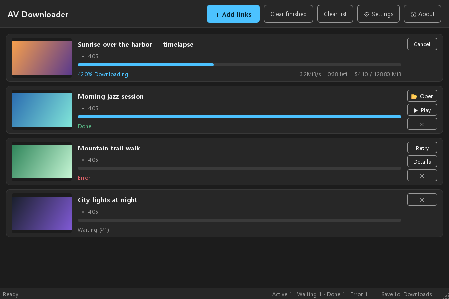
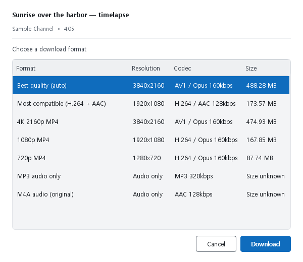
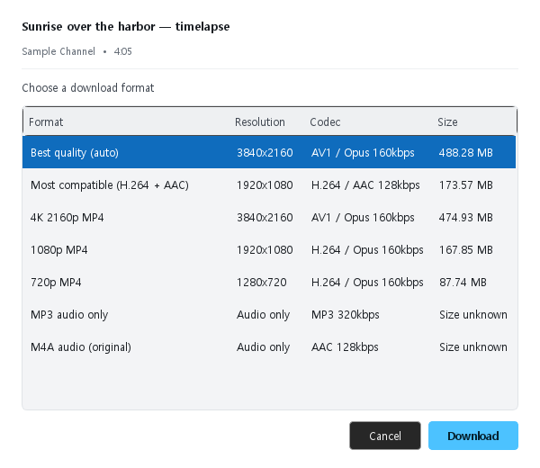

<p align="center">
  <strong>Language:</strong>
  <a href="README.md">English</a> |
  <a href="README.ko.md">한국어</a> |
  <a href="README.zh-CN.md">简体中文</a> |
  <a href="README.ja.md">日本語</a> |
  <a href="README.es.md">Español</a> |
  <a href="README.ru.md">Русский</a>
</p>

Этот документ переведён с английской версии с помощью ИИ. При расхождениях ориентируйтесь на английскую версию.

# AVD

<p align="center">
  <a href="https://github.com/metapbl/AVD/releases"></a>
  <a href="LICENSE"></a>
  <a href="#требования"></a>
  <a href="#требования"></a>
</p>

Загрузчик видео и аудио на Python на основе yt-dlp — поддерживает YouTube и более 1000 других сайтов.

## Возможности

AV Downloader — настольное приложение (PySide6), которое даёт окно для [yt-dlp](https://github.com/yt-dlp/yt-dlp), чтобы загружать без командной строки.

- Загрузка видео и аудио (MP3/M4A) со встроенными в файл метаданными и миниатюрой
- Окно выбора качества: лучшее качество, наибольшая совместимость (H.264 + AAC), каждое разрешение, MP3 или M4A; запоминает последний выбор
- Несколько загрузок одновременно с очередью, прогресс, скорость и оставшееся время в реальном времени
- Плейлисты: выбирайте только нужные элементы (до 500)
- Нормализация громкости MP3 (ReplayGain без потерь) встроенным пакетом `gaindb`
- Cookie для входа (Firefox или cookies.txt) для видео, которые может смотреть ваш собственный аккаунт, например с возрастным ограничением
- Ссылки из буфера обмена, Ctrl+V, перетаскиванием или несколькими строками сразу
- Тёмная и светлая темы; шесть языков (English, 한국어, 简体中文, 日本語, Español, Русский)
- Сам поддерживает yt-dlp в актуальном состоянии и никогда не перезаписывает файл с тем же именем

## Скриншоты

<table>
  <tr><th>Светлая</th><th>Тёмная</th></tr>
  <tr>
    <td></td>
    <td></td>
  </tr>
  <tr>
    <td></td>
    <td></td>
  </tr>
</table>

Отрисованы на примерных данных скриптом `tools/make_screenshots.py`; на экранах английский интерфейс.

## Требования

- **Windows 11** (сборка для релиза — Windows x64). **macOS** работает при запуске из исходного кода. Linux не поддерживается: там не работает открытие папки загрузок.
- **ffmpeg / ffprobe** в PATH — для объединения, преобразования в MP3/M4A и записи тегов. Windows: `winget install Gyan.FFmpeg` или [сборки Gyan](https://www.gyan.dev/ffmpeg/builds/).
- **Node.js** в PATH — в целом не обязателен, но нужен для YouTube, который заставляет yt-dlp решать JavaScript-задачу ([yt-dlp EJS](https://github.com/yt-dlp/yt-dlp/wiki/EJS)). Подойдут и Deno или Bun. Windows: `winget install OpenJS.NodeJS`.
- **Python 3.12 или новее** — только для запуска из исходного кода.

## Установка

### Релизная сборка (Windows x64)

1. Скачайте `AVD-v{версия}-win64.zip` со страницы [Releases](https://github.com/metapbl/AVD/releases) и распакуйте куда угодно. Появится папка `AVD`.
2. Установите ffmpeg и Node.js (см. [Требования](#требования)). Они не входят в сборку.
3. Запустите `AVD\AVD.exe`. Python не нужен.

Настройки хранятся в `config.json` рядом с `AVD.exe`, поэтому при переносе папки настройки переносятся вместе с ней.

### Из исходного кода

```bash
git clone https://github.com/metapbl/AVD.git
cd AVD
python -m venv venv
venv\Scripts\python -m pip install -r requirements.txt
```

Команды создают виртуальное окружение и устанавливают в него пакеты приложения. На macOS используйте `venv/bin/python` вместо `venv\Scripts\python`. `requirements.txt` намеренно фиксирует старую версию yt-dlp; приложение обновляет её при первом запуске.

## Быстрый старт

```bash
venv\Scripts\python main.py
```

Откроется окно с заголовком **AV Downloader** и номером версии, на языке системы, с пустым списком и подсказкой, как добавить ссылки. Скопируйте ссылку на видео, нажмите **Ctrl+V** в окне, выберите качество и нажмите **Загрузить**. Файл сохраняется в папку `Downloads`; когда загрузка закончится, кнопка **📂 Открыть** покажет его.

## Использование

- **Добавление ссылок** — кнопка **+ Добавить ссылки**, Ctrl+V или перетаскивание ссылок в окно. Для каждой ссылки по очереди открывается окно выбора качества; ссылка на плейлист открывает список для выбора.
- **Качество** — *Лучшее качество (авто)* выбирает yt-dlp; *Наибольшая совместимость* выбирает MP4 H.264 + AAC, который воспроизводится почти везде; MP3 и M4A сохраняют только звук.
- **Настройки (⚙)** — папка сохранения, число одновременных загрузок (рекомендуется 1–3), cookie для входа, нормализация громкости MP3, автоматическая проверка обновлений yt-dlp, язык и тема. Изменения применяются по кнопке **Сохранить**, без перезапуска.
- **Файлы** — файл с тем же именем никогда не перезаписывается; новый сохраняется как `Title (1).mp4`. Во время загрузки в папке сохранения появляется рабочая папка `.avd_*`, которая исчезает по завершении элемента. Рабочие папки, оставшиеся после аварийного завершения, удаляются через день при запуске приложения.

## Cookie для входа

Видео, для которых нужен вход в аккаунт, например с возрастным ограничением, можно загружать с cookie вашего собственного аккаунта. Включите это в **⚙ Настройки > Cookie для входа**; по умолчанию выключено.

- **Читать из Firefox** — войдите на сайт (YouTube или другой) в Firefox и выберите этот вариант. Это самый простой способ.
- **Файл cookies.txt** — для Chrome, Edge и других браузеров экспортируйте cookie в файл и выберите его. В Windows Chrome и Edge шифруют cookie для собственного использования, поэтому их нельзя прочитать напрямую.

Как создать cookies.txt (Chrome, Edge):

1. Установите расширение **Get cookies.txt LOCALLY** из Интернет-магазина Chrome (его рекомендует документация yt-dlp). Некоторые расширения с похожими названиями отправляли cookie на сторону, поэтому внимательно проверьте название.
2. Откройте **приватное окно (Инкогнито/InPrivate)** и войдите на сайт. Cookie из обычного окна сайт скоро заменяет, и экспортированный файл становится бесполезным.
3. В этом окне нажмите на расширение и выполните **Export** cookie для сайта, затем закройте приватное окно.
4. В AVD выберите файл кнопкой **Обзор** рядом с **Файл cookies.txt**.

Полезно знать:

- cookies.txt содержит ваш вход в аккаунт. Не передавайте его другим и удалите, когда закончите.
- AVD не копирует и не хранит cookie и никогда не изменяет ваш cookies.txt. В настройках сохраняются только выбранный способ и путь к файлу.
- Если за короткое время загружать много с аккаунта, в который выполнен вход, сайт может ограничить этот аккаунт.
- Содержимое, защищённое DRM, не загружается даже с cookie ([Политика распространения](#политика-распространения)).

## Состояние проекта

- Разрабатывается и проверяется в **Windows 11** — как из исходного кода, так и в релизной сборке. Каждое изменение прогоняет набор автоматических тестов (pytest).
- Запуск из исходного кода на **macOS** поддерживается, но ещё не проверен на настоящем Mac. Пакета приложения для macOS нет.
- Корейский интерфейс — оригинал. Английский переведён ИИ и проверен разработчиком; 简体中文, 日本語, Español и Русский переведены ИИ. Исправления приветствуются (см. ниже).
- Разрабатывается одним человеком вместе с ИИ-помощниками. Возможности ещё меняются от релиза к релизу; см. [CHANGELOG.md](CHANGELOG.md).

## Помощь и участие

- **Вопросы и ошибки** — создайте [issue](https://github.com/metapbl/AVD/issues). Если это ошибка загрузки, приложите текст из **Подробнее** у неудавшегося элемента.
- **Pull request** — исправления перевода и небольшие исправления ошибок приветствуются. Для крупных изменений сначала создайте issue, чтобы договориться о подходе.
- **Перед отправкой pull request** запустите тесты и линтер:

  ```bash
  venv\Scripts\python -m pip install -r requirements-dev.txt
  venv\Scripts\python -m pytest
  venv\Scripts\ruff check .
  ```

  Команды устанавливают инструменты разработки, запускают все тесты и проверяют стиль кода; все три должны завершиться без ошибок.
- **Переводы** лежат в `i18n/avd_{язык}.ts`, их можно править в Qt Linguist (`venv\Scripts\pyside6-linguist`). После правки запустите `venv\Scripts\python tools/update_translations.py`, чтобы пересобрать файлы `.qm`, и закоммитьте оба.
- Правила проекта и заметки о его устройстве — в [AGENTS.md](AGENTS.md) и [docs/](docs/) (на корейском).

## Безопасность

Сообщайте об уязвимостях приватно через GitHub: вкладка **Security** репозитория → **Report a vulnerability**. Не создавайте для них публичный issue.

## Политика распространения

**Бесплатное распространение.** Автор бесплатно распространяет AVD как открытое ПО на GitHub, не продаёт его и не предлагает платных редакций. Это лишь описание того, как автор распространяет программу; никаких ограничений к лицензиям ниже это не добавляет.

**Без обхода DRM.** Функции, помогающие обходить DRM (технические средства защиты) или получать несанкционированный доступ к платному или ограниченному содержимому, добавляться не будут, и запросы функций оцениваются по этой политике. [Cookie для входа](#cookie-для-входа) предназначены для содержимого, которое ваш собственный аккаунт уже может смотреть; это не несанкционированный доступ, и защищённое DRM содержимое по-прежнему не загружается.

## Отказ от ответственности

Используйте этот инструмент для личного обучения и резервного копирования. Соблюдение условий использования каждого сайта и закона об авторском праве — ваша ответственность; используйте его только в пределах, разрешённых законом, на свой риск.

Программа предоставляется «как есть», **без каких-либо гарантий**, включая подразумеваемые гарантии товарной пригодности или пригодности для определённой цели (положения об отсутствии гарантий как MIT, так и LGPL-2.1).

## Благодарности

- [yt-dlp](https://github.com/yt-dlp/yt-dlp) — движок загрузки
- [PySide6](https://doc.qt.io/qtforpython-6/) (Qt for Python) — графический интерфейс
- [requests](https://requests.readthedocs.io/) — миниатюры и проверка обновлений
- [psutil](https://pypi.org/project/psutil/) — остановка дочерних процессов ffmpeg/Node при отмене
- [numpy](https://numpy.org/) и [SciPy](https://scipy.org/) — анализ громкости в `gaindb`
- [GainDB](https://github.com/metapbl/GainDB) — нормализация громкости MP3, основанная на mp3gain

## Лицензия

У AVD своя лицензия для каждой папки.

- **Сам AVD** — `MIT`. Текст — в [LICENSE](LICENSE), уведомления об авторских правах и сторонних компонентах — в [NOTICE](NOTICE).
- **Встроенный пакет `gaindb/`** — `LGPL-2.1-or-later`. Он содержит код, переработанный из mp3gain (LGPL-2.1-or-later), поэтому распространяется на тех же условиях. См. [gaindb/LICENSE](gaindb/LICENSE), [gaindb/NOTICE](gaindb/NOTICE) и [gaindb/THIRD_PARTY_LICENSES](gaindb/THIRD_PARTY_LICENSES). Исходный проект: <https://github.com/metapbl/GainDB> (встроенная версия 1.1.2).

AVD вызывает только публичные функции из `gaindb.api`, поэтому является «произведением, использующим библиотеку» по §5 LGPL-2.1, и его лицензия MIT не затрагивается — так же, как при использовании PySide6 (LGPLv3) через динамическую компоновку. Где взять исходный код PySide6 и Qt, указано в разделе PySide6 файла [THIRD_PARTY_LICENSES](THIRD_PARTY_LICENSES). Для соблюдения LGPL релизная сборка хранит `gaindb/` в виде обычных файлов `.py`, которые можно заменить своей версией, а к каждому релизу на GitHub прикладывается архив исходного кода соответствующего тега.
