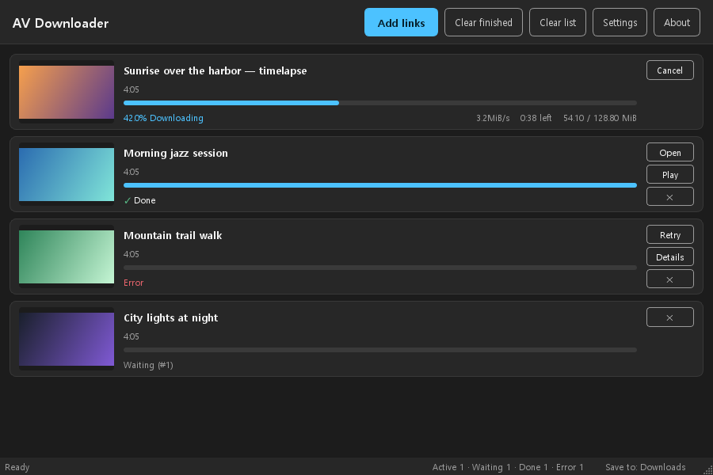
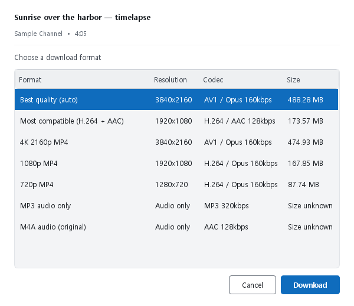
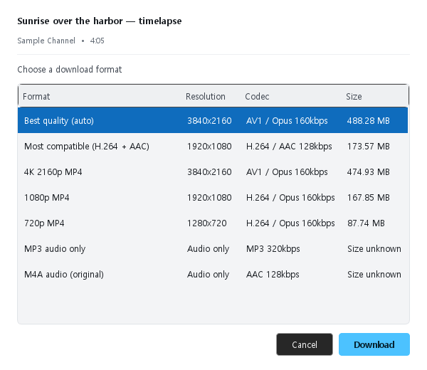

<p align="center">
  <strong>Language:</strong>
  <a href="README.md">English</a> |
  <a href="README.ko.md">한국어</a> |
  <a href="README.zh-CN.md">简体中文</a> |
  <a href="README.ja.md">日本語</a> |
  <a href="README.es.md">Español</a> |
  <a href="README.ru.md">Русский</a>
</p>

本文档由 AI 从英文版翻译而来。如有出入，以英文版为准。

# AVD

<p align="center">
  <a href="https://github.com/metapbl/AVD/releases"></a>
  <a href="LICENSE"></a>
  <a href="#系统要求"></a>
  <a href="#系统要求"></a>
</p>

基于 yt-dlp 的 Python 视频和音频下载器——支持 YouTube 及 1000 多个其他网站。

## 功能

AV Downloader 是一个桌面应用（PySide6），把 [yt-dlp](https://github.com/yt-dlp/yt-dlp) 放进一个窗口，无需命令行即可下载。

- 下载视频和音频（MP3/M4A），并把元数据和缩略图嵌入文件
- 画质选择窗口：最佳画质、最佳兼容（H.264 + AAC）、各分辨率、MP3 或 M4A；会记住上次的选择
- 多个下载同时进行并排队，实时显示进度、速度和剩余时间
- 播放列表：只选择需要的项目（最多 500 个）
- 使用随附的 `gaindb` 包进行 MP3 音量标准化（无损 ReplayGain）
- 登录 Cookie（Firefox 或 cookies.txt），可下载你自己的账号能观看的视频，例如年龄限制视频
- 从剪贴板、Ctrl+V、拖放或一次粘贴多行添加链接
- 深色和浅色主题；六种语言（English、한국어、简体中文、日本語、Español、Русский）
- 自动保持 yt-dlp 为最新版本，且从不覆盖同名文件

## 截图

<table>
  <tr><th>浅色</th><th>深色</th></tr>
  <tr>
    <td></td>
    <td></td>
  </tr>
  <tr>
    <td></td>
    <td></td>
  </tr>
</table>

由 `tools/make_screenshots.py` 用示例数据生成；界面显示为英文。

## 系统要求

- **Windows 11**（发布版为 Windows x64）。**macOS** 从源码运行即可使用。不支持 Linux：在 Linux 上无法打开下载文件夹。
- PATH 中的 **ffmpeg / ffprobe**——用于合并、MP3/M4A 转换和嵌入标签。Windows：`winget install Gyan.FFmpeg` 或 [Gyan 的构建](https://www.gyan.dev/ffmpeg/builds/)。
- PATH 中的 **Node.js**——一般情况下可选，但下载 YouTube 需要，因为 YouTube 要求 yt-dlp 解决一个 JavaScript 挑战（[yt-dlp EJS](https://github.com/yt-dlp/yt-dlp/wiki/EJS)）。Deno 或 Bun 也可以。Windows：`winget install OpenJS.NodeJS`。
- **Python 3.12 或更高版本**——仅在从源码运行时需要。

## 安装

### 发布版（Windows x64）

1. 从 [Releases](https://github.com/metapbl/AVD/releases) 下载 `AVD-v{版本}-win64.zip` 并解压到任意位置，会得到一个 `AVD` 文件夹。
2. 安装 ffmpeg 和 Node.js（见[系统要求](#系统要求)）。发布版不包含它们。
3. 运行 `AVD\AVD.exe`。不需要 Python。

设置保存在 `AVD.exe` 旁边的 `config.json` 中，因此移动文件夹时设置也会一起移动。

### 从源码

```bash
git clone https://github.com/metapbl/AVD.git
cd AVD
python -m venv venv
venv\Scripts\python -m pip install -r requirements.txt
```

这会创建一个虚拟环境，并把应用所需的包安装进去。在 macOS 上用 `venv/bin/python` 代替 `venv\Scripts\python`。`requirements.txt` 有意固定了较旧的 yt-dlp；应用首次启动时会自动更新它。

## 快速开始

```bash
venv\Scripts\python main.py
```

会打开一个标题为 **AV Downloader** 加版本号的窗口，界面使用系统语言，列表为空并提示如何添加链接。复制一个视频链接，在窗口中按 **Ctrl+V**，选择画质后按 **下载**。文件保存到 `Downloads` 文件夹；完成后点击 **打开** 即可查看。

## 使用方法

- **添加链接**——点击 **添加链接** 按钮、按 Ctrl+V，或把链接拖到窗口上。每个链接会依次打开画质选择窗口；播放列表链接会打开一个可选择的列表。
- **画质**——*最佳画质（自动选择）* 由 yt-dlp 决定；*最佳兼容* 选择几乎在任何地方都能播放的 H.264 + AAC MP4；MP3 和 M4A 只保存音频。
- **设置**——保存文件夹、同时下载数（推荐 1–3）、登录 Cookie、MP3 音量标准化、自动检查 yt-dlp 更新、语言和主题。按 **保存** 后立即生效，无需重启。
- **文件**——不会覆盖同名文件，新文件保存为 `Title (1).mp4` 这样的名字。下载期间，保存文件夹中会出现 `.avd_*` 工作文件夹，项目完成后消失。因崩溃残留的工作文件夹会在一天后应用启动时删除。

## 登录 Cookie

需要登录账号才能观看的视频（例如年龄限制视频）可以使用你自己账号的 Cookie 下载。在 **设置 > 登录 Cookie** 中开启；默认关闭。

- **从 Firefox 读取**——在 Firefox 中登录网站（YouTube 等）后选择此项。这是最简单的方法。
- **cookies.txt 文件**——对于 Chrome、Edge 等其他浏览器，把 Cookie 导出为文件后选择它。在 Windows 上，Chrome 和 Edge 会为自己加密 Cookie，因此无法直接读取。

制作 cookies.txt（Chrome、Edge）：

1. 从 Chrome 网上应用店安装 **Get cookies.txt LOCALLY** 扩展（yt-dlp 文档推荐的那个）。一些名字相似的扩展曾把 Cookie 发送到外部，请仔细核对名称。
2. 打开一个**无痕（InPrivate）窗口**并登录网站。普通窗口的 Cookie 很快会被网站替换，导出的文件也就没用了。
3. 在该窗口中点击扩展，**Export** 该网站的 Cookie，然后关闭无痕窗口。
4. 在 AVD 中，用 **cookies.txt 文件** 旁边的 **浏览** 选择该文件。

注意事项：

- cookies.txt 包含你的登录信息。不要分享给他人，用完请删除。
- AVD 不会复制或保存 Cookie，也从不修改你的 cookies.txt。设置中只保存所选方式和文件路径。
- 用已登录的账号在短时间内大量下载，网站可能会限制该账号。
- 即使有 Cookie，也不会下载受 DRM 保护的内容（[发布方针](#发布方针)）。

## 项目状态

- 在 **Windows 11** 上开发和测试，包括从源码运行和发布版。每次修改都会运行自动化测试（pytest）。
- 支持在 **macOS** 上从源码运行，但尚未在真实的 Mac 上验证。没有 macOS 应用包。
- 韩语界面为原文。英语由 AI 翻译并经开发者审阅；简体中文、日本語、Español 和 Русский 为 AI 翻译。欢迎指正（见下文）。
- 由一名开发者与 AI 助手共同开发。功能在各版本之间仍可能变化；请参阅 [CHANGELOG.md](CHANGELOG.md)。

## 帮助与贡献

- **问题和缺陷**——请提交 [issue](https://github.com/metapbl/AVD/issues)。如果是下载错误，请附上失败项目 **详情** 中的文字。
- **Pull request**——欢迎翻译更正和小的缺陷修复。较大的改动请先提交 issue，以便先商定方案。
- **提交 pull request 之前**，请运行测试和代码检查：

  ```bash
  venv\Scripts\python -m pip install -r requirements-dev.txt
  venv\Scripts\python -m pytest
  venv\Scripts\ruff check .
  ```

  这会安装开发工具、运行全部测试并检查代码风格；三条命令都应无错误地完成。
- **翻译** 位于 `i18n/avd_{语言}.ts`，可以用 Qt Linguist（`venv\Scripts\pyside6-linguist`）编辑。编辑后运行 `venv\Scripts\python tools/update_translations.py` 重新生成 `.qm` 文件，并一起提交。
- 项目规则和设计记录见 [AGENTS.md](AGENTS.md) 和 [docs/](docs/)（韩语）。

## 安全

请通过 GitHub 私下报告漏洞：仓库的 **Security** 标签页 → **Report a vulnerability**。请不要为此提交公开 issue。

## 发布方针

**免费发布。** 作者在 GitHub 上以开源形式免费发布 AVD，不出售，也不提供付费版本。这只是说明作者的发布方式，不对下述许可证增加任何限制。

**不规避 DRM。** 不会加入帮助绕过 DRM（技术保护措施）或未经授权访问付费、受限内容的功能，功能请求也按此方针判断。[登录 Cookie](#登录-cookie) 用于你自己的账号已经可以观看的内容，不属于未经授权的访问，受 DRM 保护的内容仍然不会下载。

## 免责声明

请将本工具用于个人学习和备份。遵守各网站的使用条款和著作权法是你的责任；请仅在法律允许的范围内使用，风险自负。

本软件按"原样"提供，**不提供任何保证**，包括对适销性或特定用途适用性的默示保证（MIT 和 LGPL-2.1 双方的免责条款）。

## 致谢

- [yt-dlp](https://github.com/yt-dlp/yt-dlp)——下载引擎
- [PySide6](https://doc.qt.io/qtforpython-6/)（Qt for Python）——图形界面
- [requests](https://requests.readthedocs.io/)——缩略图和更新检查
- [psutil](https://pypi.org/project/psutil/)——取消时结束 ffmpeg/Node 子进程
- [numpy](https://numpy.org/) 和 [SciPy](https://scipy.org/)——`gaindb` 中的音量分析
- [GainDB](https://github.com/metapbl/GainDB)——源自 mp3gain 的 MP3 音量标准化

## 许可证

AVD 按文件夹使用不同的许可证。

- **AVD 本体**——`MIT`。全文见 [LICENSE](LICENSE)，版权和第三方声明见 [NOTICE](NOTICE)。
- **随附的 `gaindb/` 包**——`LGPL-2.1-or-later`。其中包含改编自 mp3gain（LGPL-2.1-or-later）的代码，因此按相同条款发布。见 [gaindb/LICENSE](gaindb/LICENSE)、[gaindb/NOTICE](gaindb/NOTICE) 和 [gaindb/THIRD_PARTY_LICENSES](gaindb/THIRD_PARTY_LICENSES)。上游：<https://github.com/metapbl/GainDB>（随附版本 1.2.0）。

AVD 只调用 `gaindb.api` 中的公开函数，因此属于 LGPL-2.1 §5 所说的"使用该库的作品"，其 MIT 许可不受影响——与通过动态链接使用 PySide6（LGPLv3）相同。PySide6 和 Qt 源码的获取位置见 [THIRD_PARTY_LICENSES](THIRD_PARTY_LICENSES) 的 PySide6 部分。为遵守 LGPL，发布版把 `gaindb/` 保留为可替换为你自己版本的普通 `.py` 文件，每个 GitHub 发布版都附带对应标签的源码压缩包。
